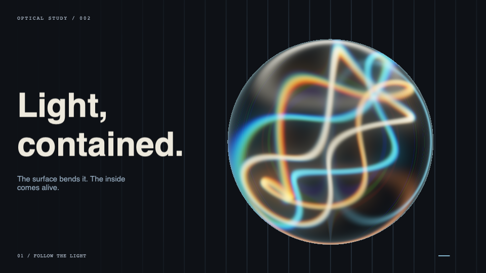

# Spectral core

A glass specimen contains three braided light filaments. Refraction magnifies
and bends the structure. Spectral separation builds, then an equatorial
cutaway exposes the core directly before the glass closes again.

[Watch the twelve-second preview](preview.mp4). It is captured from the Pixi
Stage in WebKit and encoded with FFmpeg; native app export remains unverified.

The film is silent. Landscape, portrait and square reflow from one cut.
The glass, light field, backdrop and reflections are original procedural GLSL.
System fonts need no downloads. No models, images or environment maps load.

## What this adds

The earlier `shader-study.mdx` demonstrates a metal surface. This example
traces through a transparent material and integrates light inside its volume:

- Entry and exit directions use Snell refraction. Each RGB channel follows a
  different index of refraction, using the
  [Khronos dispersion convention](https://github.com/KhronosGroup/glTF/tree/main/extensions/2.0/Khronos/KHR_materials_dispersion).
  Dispersion reaches 2.4 for an exaggerated optical study.
- Transmission attenuates with distance through the glass. Fresnel reflection
  catches the studio lights at grazing angles.
- Three curved filaments form a 3D emission and extinction field. A fixed
  64-sample integration evaluates each ray through that field.
- The cutaway blends refracted and direct views. It illustrates the optical
  paths; it does not simulate a fracture or moving pieces of physical glass.

The model follows the first transmitted path. It does not trace recursive
internal reflections, scattering or physical caustics. When the exit direction
has total internal reflection, a reflected backdrop is used as a bounded fallback.

## Edit the effect

- `full.mdx` owns the copy, formats and named moments.
- `src/optics.ts` owns the shader. `density` shapes the braid, `emission`
  integrates its light, `transmit` evaluates the optical path and `environment`
  places reflected studio lights. `backdrop` provides the grating behind it.
- `src/visual.ts` samples reveal, dispersion and opening from `seek(t)`.
  The copy stays above the filtered artwork plate.

The filter uses one source texture sample and procedural math in one pass.
At most four rays integrate the volume: the direct view plus RGB transmission.
Bounding-sphere tests skip empty paths; the cutaway skips optical paths that
do not contribute to a pixel. The integration budget is fixed;
thin filaments need adequate sampling to avoid shimmer. The filter inherits
preview resolution. Its input plate is opaque.

## Review

Inspect 0.1, 2.4, 4.5, 6.5, 8.2 and 11.2 seconds in all formats.
At 6.5, the cutaway should show refracted and direct light at once. Compare
dispersion 0 with 2.4 at the same time; the internal structure should separate
in color while the copy remains sharp. Seek backward from 11.2 to 2.4 and
4.5 and check that each frame repeats.

Inspect the entire motion for filament shimmer, the glass silhouette and
clearance around the copy. Check reduced preview resolution and measure on
the target device. This shader costs more than a basic color filter; a short
browser timing batch does not establish sustained app frame rate.

Run the layout/redraw checks. For native encoded output, export a range across
the opening, decode it and compare the same times. Record app and source
revisions; the bundled browser preview does not establish native acceptance.
